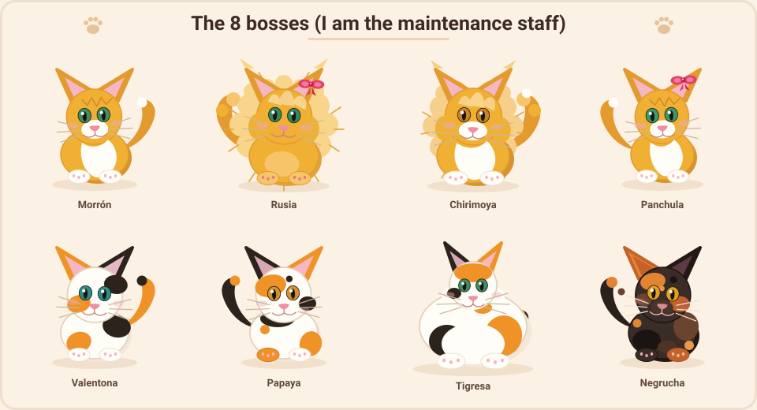

  

# Sup, im Dolan 👋

  
  
<strong>I LIKE TO EAT COMPLETOS</strong>

## How to build a completo (didactic)

A completo is a Chilean hot dog. Tomate, palta, and mayo are the Italian flag. That stack is a *completo italiano*. Build upward.

| Layer | Ingredient | Why |
| --- | --- | --- |
| 1 | pan | The bun. Load-bearing. Toast if you want; commit either way. |
| 2 | vienesa | The sausage. Protagonist. Everything above it is costume. |
| 3 | tomate | Diced tomato. Red stripe. Acid, so the mayo meets resistance. |
| 4 | palta | Mashed avocado. Green stripe. The creamy vote. |
| 5 | mayo | White stripe, zigzagged until the bun surrenders. Now it is completo. |

## 📍 Current Status / AFK

- 🚶‍♂️ Walking or cycling around Las Cabras.
- ⛰️ Lost on some mountain doing trekking.
- 🐈 Serving as maintenance staff for my 8 cats.
- 🏎️ Daydreaming about a *Subaru Impreza GC8* or a *Nissan Skyline R32* engine.

## 🐈 The 8 bosses

Roster of the 8 bosses

| Name | Description |
| --- | --- |
| Morrón | rubio tuxedo de pelo corto |
| Rusia | rubia de pelo largo |
| Chirimoya | rubio tuxedo de pelo largo |
| Panchula | rubia tuxedo de pelo corto |
| Valentona | calico |
| Papaya | calico |
| Tigresa | calico gorda |
| Negrucha | carey |

  

